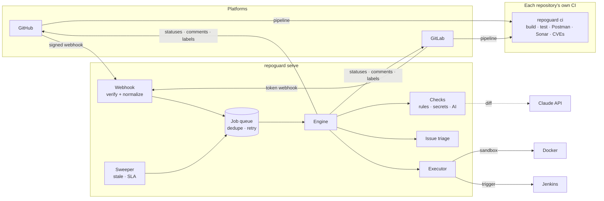
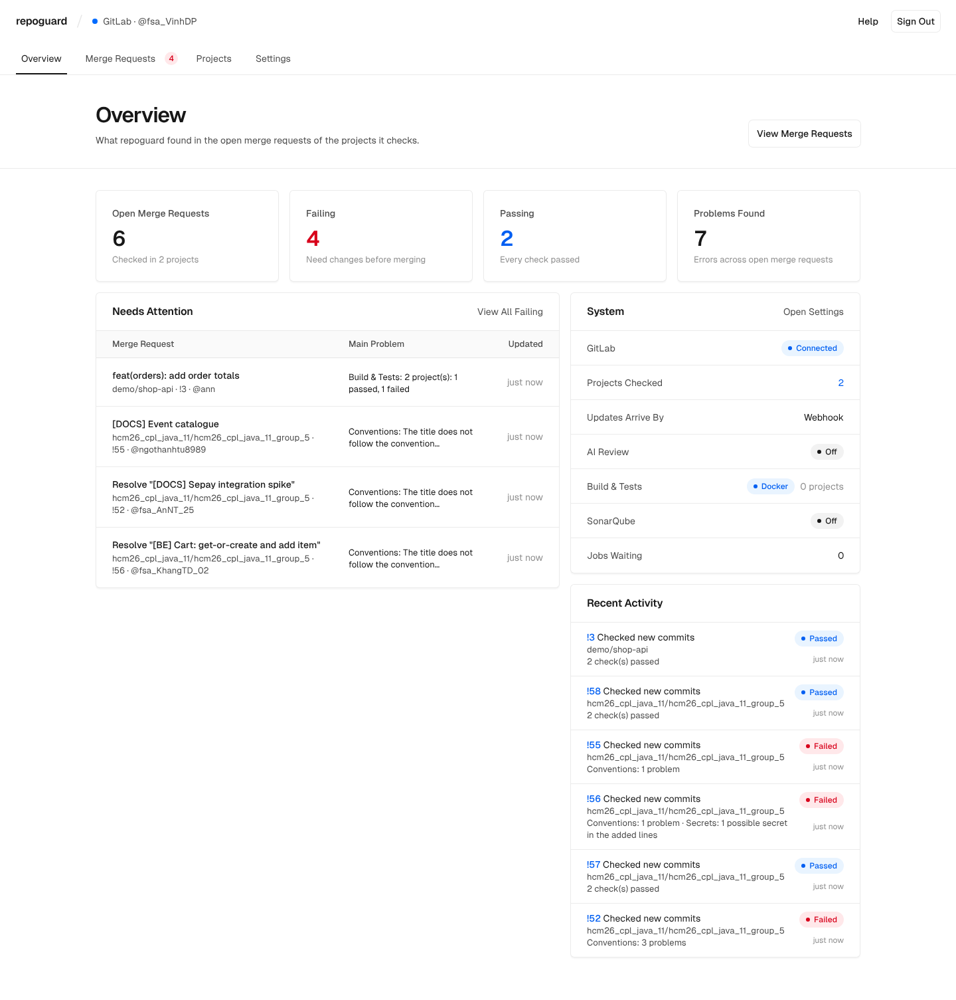
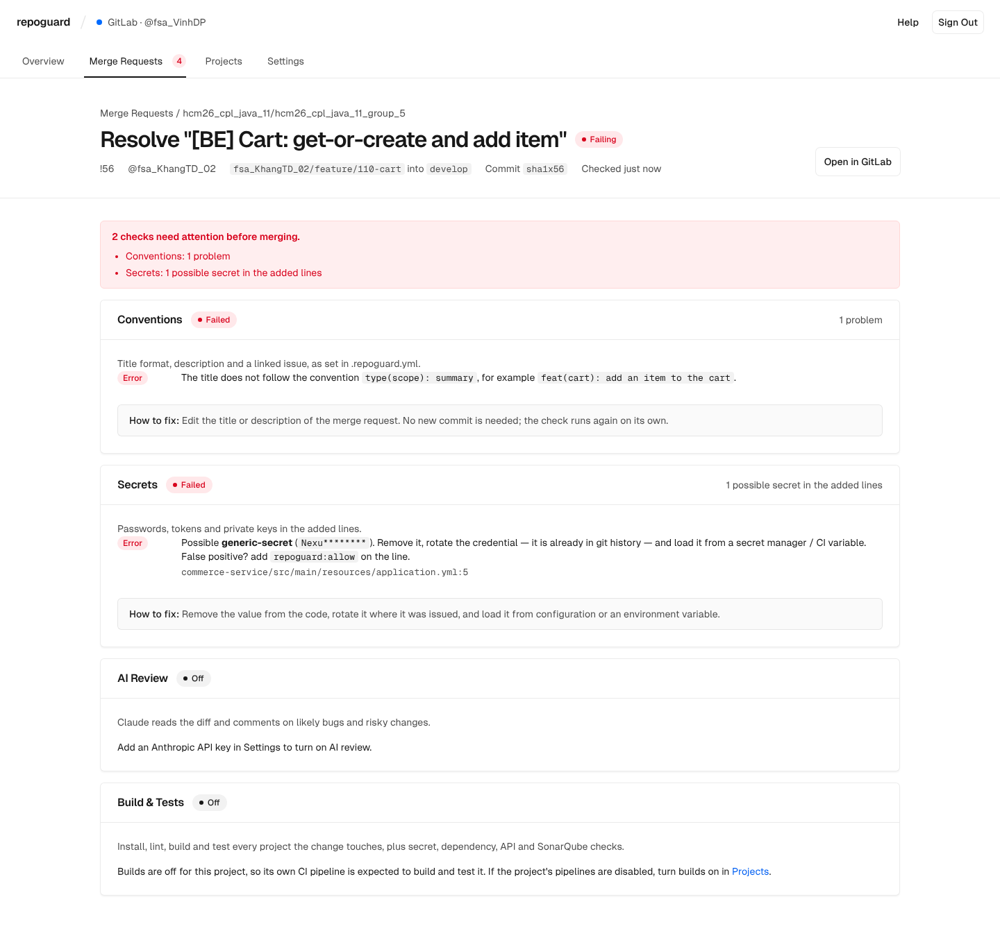

# repoguard

**Automated code and issue checks for GitHub and GitLab: one service, many repositories.**

[](https://github.com/dpvinh30092005/repoguard/actions/workflows/ci.yml)


Connect a repository and repoguard reviews every pull/merge request and every new issue.
It enforces team conventions, catches leaked secrets, gives AI review comments, runs your
builds, tests, Postman collections and SonarQube analysis, and keeps the issue tracker tidy.
Results come back where developers already look: commit statuses, one sticky summary
comment and inline review comments.

---

## Contents

- [Features](#features)
- [How it works](#how-it-works)
- [Quick start](#quick-start)
- [Connecting repositories](#connecting-repositories)
- [Configuration](#configuration)
- [Integrations: Postman, SonarQube, Jenkins](#integrations-postman-sonarqube-jenkins)
- [Executor: CI for projects without pipelines](#executor-ci-for-projects-without-pipelines)
- [Operations](#operations)
- [Security model](#security-model)
- [Project layout](#project-layout)
- [Development](#development)
- [Roadmap](#roadmap)

## Features

| Area | What repoguard does | Runs in |
|---|---|---|
| **PR/MR rules** | Conventional-commit titles, a real description, a linked issue, warnings for oversized changes | Service |
| **Secret scanning** | AWS, GitHub, GitLab, Slack, Stripe and Anthropic keys, private keys, high-entropy passwords in *added* lines; values are always masked | Service + CI |
| **AI review** | Claude reads the diff and leaves ranked inline comments (critical → nit). Advisory by default | Service |
| **Build & test** | Detects Go, Node.js and Python projects (many per repository) and runs install → lint → build → test | Your CI / executor |
| **Dependency CVEs** | `osv-scanner` across every ecosystem | Your CI / executor |
| **API tests** | Runs Postman collections with Newman, optionally starting the API first | Your CI / executor |
| **Code quality** | Runs `sonar-scanner` and reports the SonarQube Quality Gate and key metrics | Your CI / executor |
| **Issue triage** | Asks reporters for missing details, auto-labels, flags likely duplicates | Service |
| **Issue lifecycle** | Marks and closes stale issues; flags high-priority issues nobody picked up | Service (periodic sweep) |
| **Issue ↔ PR links** | Requires a linked issue, notes the PR on the issue, closes it on merge | Service |
| **Executor** | Builds merge requests itself, in a sandbox or on Jenkins, when a project has no working CI | Service + Docker/Jenkins |
| **Web console** | Every merge request with the result of each check, the exact problems and how to fix them; connect GitLab/GitHub, choose projects and turn builds on. Polling mode needs no public URL | Service |

## How it works



repoguard is deliberately split in two:

- **`repoguard serve`** is a multi-tenant service. It reads metadata and diffs through the
  platform APIs and **never executes repository code**, so one malicious pull request can't
  take over a server that every repository shares.
- **`repoguard ci`** runs the work that *does* execute code: builds, tests, Postman, Sonar
  and dependency scans. It runs on each repository's own runners (GitHub Actions, GitLab CI,
  Jenkins), or in the opt-in [executor](#executor-ci-for-projects-without-pipelines) when a
  project has no CI.

Both halves share one binary and one policy file, `.repoguard.yml`.

## Quick start

**Requirements:** Go 1.24+ to build from source, or Docker.

### Check a repository locally

```bash
git clone https://github.com/dpvinh30092005/repoguard && cd repoguard
make build
./bin/repoguard ci --dir /path/to/your/repo
```

This prints a Markdown report and writes `repoguard-report.md` and `repoguard-junit.xml`.
Add `--json report.json` for machine-readable output, `--base origin/main` to check only the
projects a branch changed, and `--no-vuln` to skip the dependency scan.

### Run the service and set it up in the browser

```bash
docker compose -f deploy/docker-compose.executor.yml up -d     # or deploy/docker-compose.yml without CI builds
docker compose -f deploy/docker-compose.executor.yml logs repoguard | grep "admin password"
```

Open **http://localhost:47474**, sign in, then:

1. **Settings**: paste a GitLab address and access token (or a GitHub token) and select *Save Connection*.
2. **Projects**: select *Start Checking* next to a project and, if its pipelines are disabled, *Turn On Builds*.
   For merge requests that are already open, select *Run Checks*.
3. **Merge Requests**: every checked merge request with the result of each check. Select one to
   see the exact problems, where they are and how to fix them. The same summary is posted as one
   comment on the merge request, and each commit status links back to this page.

Without a public URL, repoguard **polls** GitLab/GitHub every 30 seconds, so this works on a
laptop with no open ports. Set a public URL (behind TLS) and it creates **webhooks** instead, for
instant reactions. Every setting can also come from environment variables, which take precedence
over the UI (see [Configuration](#configuration)).





The console follows Vercel's [Geist](https://vercel.com/geist) design system and ships the Geist
Sans and Geist Mono fonts (SIL Open Font License, `internal/web/static/fonts/OFL.txt`) inside the
binary, so it works offline. The latest result of each merge request is kept in `results.json`
next to the settings, so the history survives a restart.

### Prebuilt images

Every release tag publishes public images to GHCR (`:1` tracks the latest 1.x, `:1.0.0` is fixed).
The compose files pull them, so you don't have to build anything; add `--build` to build from
source instead.

| Image | Purpose |
|---|---|
| `ghcr.io/dpvinh30092005/repoguard` | The service (distroless, no CI builds) |
| `ghcr.io/dpvinh30092005/repoguard-executor` | The service plus Docker CLI and git, for CI builds |
| `ghcr.io/dpvinh30092005/repoguard-ci` | The build image: Go, Node, Python, Newman, sonar-scanner, osv-scanner |

### Try everything at once

[`deploy/stack`](deploy/stack) starts repoguard, **SonarQube** and a pre-configured **Jenkins**
with one command:

```bash
cp deploy/stack/.env.example deploy/stack/.env
docker compose -f deploy/stack/docker-compose.yml up -d --build
deploy/stack/init-sonar.sh        # once: prints a SonarQube token for .env
```

| Service | URL |
|---|---|
| repoguard | http://localhost:47474 |
| Jenkins | http://localhost:8081 |
| SonarQube | http://localhost:9000 |

## Connecting repositories

| Step | GitHub | GitLab |
|---|---|---|
| 1. Service access | Create a GitHub App ([guide](docs/setup-github.md)) | Create a bot or group access token with `api` scope ([guide](docs/setup-gitlab.md)) |
| 2. Per repository | Install the App on the repository or organization | Add a project or **group** webhook (groups cover every sub-project) |
| 3. CI half (optional) | Copy [`ci-templates/github/repoguard.yml`](ci-templates/github/repoguard.yml) | `include:` [`ci-templates/gitlab/repoguard.gitlab-ci.yml`](ci-templates/gitlab/repoguard.gitlab-ci.yml) |
| 4. Policy (optional) | Commit `.repoguard.yml` to the default branch | Same |
| 5. Enforce | Require `repoguard/pr-rules`, `repoguard/secrets` and the CI job in branch protection | *Pipelines must succeed* |

GitHub repositories reuse the CI half as a reusable workflow (`@v1` follows the latest 1.x
release; pin `@v1.0.0` or a commit SHA for fully reproducible builds):

```yaml
# .github/workflows/repoguard.yml
on: [pull_request]
jobs:
  repoguard:
    uses: dpvinh30092005/repoguard/.github/workflows/repoguard-ci.yml@v1
```

> The detailed guides in [`docs/`](docs) are currently written in Vietnamese.

## Configuration

### Repository policy: `.repoguard.yml`

Every key is optional; a repository only states what differs from the defaults. The file is
read from the **default branch**, so a pull request cannot weaken its own checks. Unknown keys
are rejected, so typos fail loudly instead of being ignored.

```yaml
pull_request:
  title_pattern: '^(feat|fix|docs|refactor|test|chore)(\(.+\))?: .{3,}'
  require_linked_issue: true
  max_changed_lines: 600          # warning only

ai_review:
  fail_on_critical: false         # AI comments are advisory unless you opt in
  instructions: |
    Flag raw SQL string building; we use parameterized queries.

issues:
  stale: { days_until_stale: 60, days_until_close: 14 }

ci:
  postman:
    start: npm --prefix api start
    wait_url: http://127.0.0.1:3000/health
  sonar:
    fail_on_gate: true
```

See [`.repoguard.example.yml`](.repoguard.example.yml) for every option with its default.

### Service environment

| Variable | Default | Purpose |
|---|---|---|
| `REPOGUARD_ADDR` | `:47474` | Listen address |
| `REPOGUARD_ADMIN_PASSWORD` | generated, printed in the log | Web console password |
| `REPOGUARD_DATA_DIR` | `data` (`/data` in images) | Where settings entered in the web console and the latest results are stored |
| `REPOGUARD_POLL_INTERVAL` | `30s` | How often projects in polling mode are checked |
| `REPOGUARD_WORKERS` / `REPOGUARD_QUEUE_SIZE` | `8` / `1000` | Worker pool and queue capacity |
| `REPOGUARD_SWEEP_INTERVAL` | `6h` | Stale/SLA sweep interval (`0` disables; use `repoguard sweep` from cron) |
| `REPOGUARD_PUBLIC_URL` | – | Link shown on commit statuses |
| `GITHUB_APP_ID`, `GITHUB_APP_PRIVATE_KEY` or `_FILE` | – | GitHub App credentials (recommended) |
| `GITHUB_TOKEN` | – | Alternative to an App: a bot token |
| `GITHUB_WEBHOOK_SECRET` | – | Required to accept GitHub webhooks |
| `GITHUB_API_URL` | `https://api.github.com` | GitHub Enterprise Server: `https://ghe.example.com/api/v3` |
| `GITLAB_URL`, `GITLAB_TOKEN`, `GITLAB_WEBHOOK_SECRET` | `https://gitlab.com` | GitLab.com or self-managed |
| `ANTHROPIC_API_KEY` | – | Enables AI review |
| `REPOGUARD_AI_MODEL` / `REPOGUARD_AI_EFFORT` | `claude-opus-5-5` / `high` | Review model and effort |

Executor, Jenkins and SonarQube variables are listed in [their section](#executor-ci-for-projects-without-pipelines).

## Integrations: Postman, SonarQube, Jenkins

repoguard orchestrates these tools through their official CLIs and APIs. It does not embed
their code, and it puts their results next to everything else on the pull request.

| Tool | How it is used | Enable with |
|---|---|---|
| **Postman** | Every `*.postman_collection.json` runs with [Newman](https://github.com/postmanlabs/newman). repoguard can start the API, wait for a health URL, then stop it | Commit a collection; optional `ci.postman` |
| **SonarQube** | `sonar-scanner` analyses the code; repoguard reads the Quality Gate, bugs, vulnerabilities, coverage and duplication | `SONAR_HOST_URL` + `SONAR_TOKEN` in the build environment |
| **Jenkins** | Alternative build backend: repoguard triggers a parameterized job, waits, and reads the report artifact back | `REPOGUARD_EXECUTOR=jenkins` |

Details: [docs/integrations.md](docs/integrations.md). The demo stack and a real Jenkins +
SonarQube run are exercised in CI on every push.

## Executor: CI for projects without pipelines

When a project's own CI is unavailable (for example, GitLab pipelines are disabled), repoguard
can build merge requests itself and post a **🧪 repoguard ci** comment with per-project results.

It is opt-in and fenced:

- Nothing is built unless builds are turned on for the project in the web console, or the
  repository matches `REPOGUARD_EXECUTOR_REPOS`.
- Only authors with Developer/write access are built; **forks never are**.
- The policy comes from the default branch, never from the merge request.
- Credentials stay out of the build: the token is used for `git fetch` on the host only.
- Each build runs in a fresh container with all capabilities dropped and limits on CPU,
  memory, process count and time. gVisor is optional.

| Variable | Default | Purpose |
|---|---|---|
| `REPOGUARD_EXECUTOR` | auto | `docker`, `jenkins` or `off`. Auto follows the web console's choice, Docker by default |
| `REPOGUARD_EXECUTOR_REPOS` | – | Comma-separated repository globs allowed to build, e.g. `team/*` |
| `REPOGUARD_EXECUTOR_IMAGE` | `ghcr.io/dpvinh30092005/repoguard-ci:1` | Build image (Go, Node, Python, Newman, sonar-scanner, osv-scanner) |
| `REPOGUARD_EXECUTOR_CPUS` / `_MEMORY` / `_PIDS_LIMIT` | `2` / `4g` / `1024` | Per-build limits |
| `REPOGUARD_EXECUTOR_TIMEOUT` / `_CONCURRENCY` | `20m` / `2` | Wall clock per build, parallel builds |
| `REPOGUARD_EXECUTOR_NETWORK` / `_RUNTIME` | `bridge` / – | Container network (`none` for offline builds), e.g. `runsc` |
| `JENKINS_URL`, `JENKINS_USER`, `JENKINS_TOKEN`, `JENKINS_JOB` | job `repoguard-ci` | Jenkins backend ([Jenkinsfile](ci-templates/jenkins/Jenkinsfile)) |
| `SONAR_HOST_URL`, `SONAR_TOKEN` | – | Passed into sandboxed builds by name only |

To build the image locally instead of pulling it, run
`docker build -f deploy/ci-runner.Dockerfile -t repoguard-ci:local .` and set
`REPOGUARD_EXECUTOR_IMAGE=repoguard-ci:local`. Full guide: [docs/executor.md](docs/executor.md).

## Operations

- **Probes:** `GET /healthz` (liveness) and `GET /readyz` (fails while the queue is over 90% full).
- **Metrics:** `GET /metrics` in Prometheus text format: `repoguard_webhooks_total`,
  `repoguard_events_total`, `repoguard_checks_total`, `repoguard_jobs_total`,
  `repoguard_executor_runs_total`, `repoguard_queue_depth`.
- **Logs:** structured JSON with `repo`, `event`, `number` and `delivery` fields. Search by the
  platform's delivery ID.
- **Back-pressure:** with a full queue, webhooks get `503` with `Retry-After`, so the platform
  redelivers instead of the event being dropped.
- **Alert on:** a rise in `result="unauthorized"` webhooks, failed jobs, or a sustained high queue depth.

## Security model

- Webhooks are authenticated: HMAC-SHA256 on GitHub, constant-time token comparison on GitLab.
- GitHub App installation tokens are short-lived, cached, and refreshed automatically.
- Detected secrets are never echoed; reports show only the first four characters.
- Pull request content sent to the model is marked as untrusted data, which guards against
  prompt injection. Team instructions come only from the default-branch policy.
- The service never runs repository code; the executor is opt-in and sandboxed (see above).
- The web console uses one admin password, HMAC-signed session cookies and same-origin checks
  on every change. Tokens are stored in a `0600` file and never shown back in the UI.
- Idempotent writes and content fingerprints make sure retries and repeated pushes never
  post duplicate comments.

## Project layout

```
cmd/repoguard/          CLI: serve | ci | sweep | version
internal/
  platform/             provider-neutral model and client interface
    github/ gitlab/     API clients and webhook parsers
  engine/               events → checks/triage → statuses, comments, labels
  checks/               pr-rules, secrets, aireview (Claude)
  triage/               issue assessment, duplicates (TF-IDF), stale, SLA, issue references
  ci/                   `repoguard ci`: project detection, stages, Postman, Sonar, reports
  executor/             sandboxed and Jenkins builds for repositories without CI
  web/ store/ poller/   web console, saved settings, change detection without webhooks
  results/              latest result of each change request, for the console
  queue/ server/ config/ diff/ glob/ metrics/
ci-templates/           drop-in CI for GitHub, GitLab and Jenkins
deploy/                 Dockerfiles, compose files, demo stack (SonarQube + Jenkins)
docs/                   setup guides
```

## Development

```bash
make test        # unit tests with the race detector
make lint        # gofmt + go vet
make build       # bin/repoguard
make ci          # run `repoguard ci` on this repository
```

Integration tests talk to real infrastructure and are behind a build tag:

```bash
docker build -f deploy/ci-runner.Dockerfile -t repoguard-ci:test .
REPOGUARD_TEST_IMAGE=repoguard-ci:test go test -tags integration -run Docker ./internal/executor/
```

GitHub Actions runs all of this on every push: unit tests, `govulncheck`, the Docker
sandbox, a real SonarQube analysis, and a real Jenkins build of
[monorepo-ci](https://github.com/dpvinh30092005/monorepo-ci) through the executor.

## Roadmap

- **High availability:** the job queue is in-memory, so run one replica for now. Moving it to
  Redis/NATS/SQS behind the same interface enables multiple replicas.
- **CI results in the summary comment:** have `repoguard ci` report back to the service with
  CI OIDC tokens.
- Bitbucket and Gitea support, organization-wide default policies, SARIF upload to GitHub
  code scanning, embedding-based duplicate detection.

## Contributing

Issues and pull requests are welcome. Please run `make lint test` before opening a pull
request; repoguard checks its own pull requests too.

This repository does not include a license yet. Until one is added, all rights are reserved
by the author.
