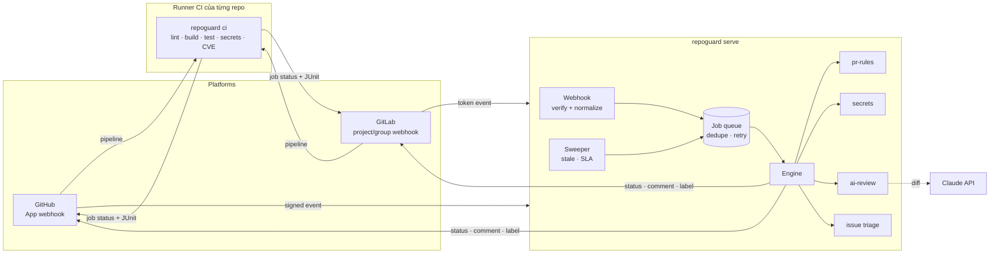

# repoguard

Tool kiểm tra **code** và **issue** cho nhiều repo cùng lúc, chạy trên **GitHub** và **GitLab**.
Repo nào "connect" (cài GitHub App / thêm webhook GitLab) là được kiểm tra tự động.

| Nhóm | Tính năng | Chạy ở đâu |
|---|---|---|
| Quy tắc PR/MR | title theo convention, có mô tả, có link issue, cảnh báo PR quá lớn | Service |
| Secret | phát hiện AWS/GitHub/GitLab/Slack/Stripe/Anthropic key, private key, password entropy cao trong dòng **được thêm** | Service (+ cả repo trong CI) |
| AI review | Claude đọc diff, comment inline theo mức critical/major/minor/nit | Service |
| Lint + build + test | tự nhận Go / Node / Python, **nhiều project trong một repo** | CI của repo |
| Dependency CVE | `osv-scanner` (mọi ecosystem, OSV database) | CI của repo |
| Issue | thiếu thông tin → hỏi lại + label `needs-info`; tự gắn label; phát hiện trùng lặp | Service |
| Issue lifecycle | stale → nhắc → đóng; cảnh báo SLA cho bug P0 chưa ai nhận | Service (sweep định kỳ) |
| Issue ↔ PR | PR phải link issue; comment lên issue khi có PR; merge xong tự đóng issue | Service |
| **Postman / SonarQube / Jenkins** | Chạy Postman collection bằng Newman, quét SonarQube + Quality Gate, hoặc build qua Jenkins; có bộ docker-compose dựng sẵn | CI / executor → [docs/integrations.md](docs/integrations.md) |
| **Executor** (tuỳ chọn) | repo **không có/không được chạy CI** (GitLab tắt pipeline): service tự build MR trong container cách ly | Service + Docker → [docs/executor.md](docs/executor.md) |

## Kiến trúc



**Vì sao chia làm hai nửa (hybrid)?**

- **Service** chỉ đọc metadata và diff qua API, **không bao giờ chạy code của repo**. Nhờ vậy service
  đa tenant mà an toàn: một PR độc hại không thể chiếm server dùng chung cho mọi repo.
- **Build/test/quét dependency** chạy code của repo, nên chạy trên **runner của chính repo đó**
  (GitHub Actions / GitLab CI). Repo tự trả tài nguyên, có sẵn toolchain và secret của nó.
- Cả hai dùng chung một binary và chung file policy `.repoguard.yml`.

Các quyết định thiết kế khác:

| Quyết định | Lý do |
|---|---|
| Lớp `platform.Client` trung lập | Check/triage không biết GitHub hay GitLab. Thêm Bitbucket/Gitea = viết 1 client + 1 webhook parser |
| Policy đọc từ **default branch** | Nếu đọc từ nhánh PR, PR có thể tự tắt check của chính nó |
| Webhook trả `202` ngay, xử lý trong queue | GitHub chỉ đợi 10s; queue có dedupe (redelivery), retry backoff cho 429/5xx, chặn panic |
| Event chỉ là "gợi ý", luôn đọc lại state qua API | Payload có thể cũ hoặc đến sai thứ tự |
| Sticky comment (marker ẩn) + fingerprint cho inline comment | Push nhiều lần cũng không spam; finding cũ không bị đăng lại |
| Ghi idempotent trước, inline review (không idempotent) sau cùng | Retry sau lỗi giữa chừng không đăng trùng |
| AI review mặc định **chỉ góp ý**, không chặn merge | False positive của LLM không được làm kẹt team; bật `fail_on_critical` nếu muốn |
| AI chỉ chạy khi có commit mới, không chạy khi sửa title | Tiết kiệm chi phí; prompt tĩnh được cache |
| Không lưu state (stateless) | Scale ngang dễ; mất job khi restart thì event sau / sweep sau bù lại |
| Không dùng SDK GitHub/GitLab | Chỉ cần ~15 endpoint; client mỏng, dễ test bằng fake server, ít dependency |

## Cấu trúc

```
cmd/repoguard/            serve | ci | sweep | version
internal/
  platform/               model trung lập + interface Client + REST helper
    github/               GitHub App auth (JWT → installation token), client, webhook HMAC
    gitlab/               client, webhook token, Note/Issue/MR hooks
  engine/                 event → check/triage → status/comment/label
  checks/                 pr-rules, secrets, aireview (Claude)
  triage/                 phân loại issue, section thiếu, trùng lặp TF-IDF, stale, SLA, issue refs
  ci/                     `repoguard ci`: detect project, chạy stage, quét secret/CVE, report MD + JUnit + JSON
  executor/               chạy `repoguard ci` trong sandbox Docker cho repo không có CI
  queue/ server/ config/ diff/ glob/ metrics/
.github/workflows/
  repoguard-ci.yml        reusable workflow cho repo khác gọi
  ci.yml                  CI của chính repoguard (test, govulncheck, tự kiểm tra, build image)
ci-templates/             file mẫu để repo khác dùng (GitHub + GitLab)
deploy/                   Dockerfile service / CI runner / executor, docker-compose, .env.example
.repoguard.example.yml    toàn bộ cấu hình, có chú thích
```

## Bắt đầu nhanh

```bash
make test                       # unit + end-to-end test (fake GitHub API)
make build
./bin/repoguard ci --dir ../some-repo   # chạy phần CI trên một repo bất kỳ ở máy local
```

Chạy service ở local, nhận webhook thật qua tunnel:

```bash
cp deploy/.env.example deploy/.env      # điền secret
make run                                # :8080
npx smee-client -u https://smee.io/<kênh> -t http://localhost:8080/webhooks/github
```

Deploy: `docker compose -f deploy/docker-compose.yml up -d` (đặt sau TLS), hoặc chạy image
`ghcr.io/<owner>/repoguard` trên Kubernetes/Cloud Run/ECS với probe `/healthz`, `/readyz`.

## Kết nối một repo

| | GitHub | GitLab |
|---|---|---|
| 1. Service | Tạo GitHub App một lần → [docs/setup-github.md](docs/setup-github.md) | Tạo bot token + webhook → [docs/setup-gitlab.md](docs/setup-gitlab.md) |
| 2. Mỗi repo | Cài App vào repo/org | Thêm webhook ở project hoặc **group** (áp dụng cho mọi project con) |
| 3. CI (tùy chọn) | Copy [`ci-templates/github/repoguard.yml`](ci-templates/github/repoguard.yml) | `include:` [`ci-templates/gitlab/repoguard.gitlab-ci.yml`](ci-templates/gitlab/repoguard.gitlab-ci.yml) |
| 4. Policy (tùy chọn) | `.repoguard.yml` trên default branch, xem [`.repoguard.example.yml`](.repoguard.example.yml) | như GitHub |
| 5. Bắt buộc check | Branch protection: require `repoguard/pr-rules`, `repoguard/secrets`, `repoguard / repoguard ci` | Settings → Merge requests → *Pipelines must succeed* |

Kết quả xuất hiện trên PR/MR dưới dạng:
- **commit status** `repoguard/pr-rules`, `repoguard/secrets`, `repoguard/ai-review`
- **một comment tóm tắt** được cập nhật tại chỗ mỗi lần push
- **comment inline** cho secret và góp ý của AI
- pipeline `repoguard ci` với bảng lint/build/test theo từng project (job summary trên GitHub, widget JUnit trên GitLab)

## Cấu hình service (biến môi trường)

| Biến | Mặc định | Ý nghĩa |
|---|---|---|
| `REPOGUARD_ADDR` | `:8080` | địa chỉ lắng nghe |
| `REPOGUARD_WORKERS` / `REPOGUARD_QUEUE_SIZE` | `8` / `1000` | số worker và sức chứa queue |
| `REPOGUARD_SWEEP_INTERVAL` | `6h` | chu kỳ sweep stale/SLA (`0` = tắt, dùng `repoguard sweep` qua cron) |
| `GITHUB_APP_ID`, `GITHUB_APP_PRIVATE_KEY(_FILE)` | | GitHub App (khuyến nghị) |
| `GITHUB_TOKEN` | | thay cho App: PAT của tài khoản bot |
| `GITHUB_WEBHOOK_SECRET` | | bắt buộc nếu bật GitHub |
| `GITHUB_API_URL` | `https://api.github.com` | GitHub Enterprise: `https://ghe.example.com/api/v3` |
| `GITLAB_URL`, `GITLAB_TOKEN`, `GITLAB_WEBHOOK_SECRET` | `https://gitlab.com` | GitLab.com hoặc self-managed |
| `ANTHROPIC_API_KEY` | | bật AI review |
| `REPOGUARD_AI_MODEL` / `REPOGUARD_AI_EFFORT` | `claude-opus-5-5` / `high` | model và mức effort |

AI review gửi kèm `fallbacks: "default"` (server-side fallback, beta `server-side-fallback-2026-07-01`):
nếu bộ phân loại an toàn từ chối một diff, API tự chạy lại request đó trên model dự phòng
thay vì trả lỗi. Bỏ tùy chọn này trong `internal/checks/aireview/claude.go` nếu không muốn dùng.

## Vận hành

- **Metrics** (`/metrics`, định dạng Prometheus): `repoguard_webhooks_total{platform,result}`,
  `repoguard_events_total{type,result}`, `repoguard_checks_total{check,state}`, `repoguard_jobs_total{result}`,
  `repoguard_queue_depth`.
- Gợi ý alert: `result="unauthorized"` tăng (sai secret hoặc bị dò), `jobs_total{result="failed"}` tăng,
  `queue_depth` cao kéo dài.
- Log JSON có `repo`, `event`, `number`, `delivery` để tra theo delivery ID của GitHub/GitLab.
- Queue đầy → webhook trả `503 + Retry-After`, platform sẽ gửi lại thay vì mất event.

## Bảo mật

- Webhook được xác thực: HMAC-SHA256 (GitHub), token so sánh constant-time (GitLab).
- GitHub App dùng token theo installation, sống 1 giờ, cache và tự làm mới. Quyền tối thiểu: xem docs.
- Secret bị phát hiện **không bao giờ in nguyên văn** (chỉ hiện 4 ký tự đầu), vì comment là công khai.
- Nội dung PR đưa cho AI được đánh dấu là dữ liệu không tin cậy (chống prompt injection);
  hướng dẫn riêng của team chỉ lấy từ `.repoguard.yml` trên default branch.
- Service không clone, không chạy code của repo, **trừ khi** bật executor cho các repo được liệt kê;
  khi đó code chạy trong container dùng một lần, có giới hạn, không có credential (xem [docs/executor.md](docs/executor.md)).

## Giới hạn hiện tại & lộ trình

- Queue nằm trong bộ nhớ → chỉ chạy **1 replica**. Muốn HA: chuyển `queue` sang Redis/NATS/SQS
  (giữ nguyên interface) và chạy nhiều replica sau load balancer.
- Phát hiện trùng lặp dùng TF-IDF (không cần dịch vụ ngoài). Nếu recall chưa đủ, đổi sang embedding
  mà vẫn giữ signature của `triage.FindDuplicates`.
- Kết quả `repoguard ci` hiển thị qua status của pipeline, chưa gộp vào comment tóm tắt của service.
  Bước tiếp theo: CI gửi report JSON lên `POST /api/reports` (xác thực bằng OIDC token của CI).
- Bổ sung sau: Bitbucket/Gitea, dashboard nhiều repo, cấu hình mặc định cấp org (`.github` repo / group),
  rule secret tùy biến, SARIF upload lên GitHub code scanning.
